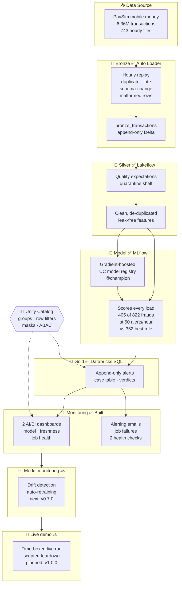

 

## 👋 Hi, I'm Deepan Mehta

*"When learning meets data, growth becomes measurable and inevitable."*

**Applied AI Engineer | Forward Deployed Engineer | Data Analytics | Data Engineering | AI Systems**

As a **Forward Deployed Engineer** my role is to provide AI backed solutions to legacy Enterprise Systems across **ANY TECH STACK as needed by clients.**

**It could be Google Cloud, Databricks, AWS, Snowflake, Agentic solutions and more.**  

Building end-to-end AI solutions across ETL, analytics, machine learning and AI engineering

**Current Projects:**

- 🛡️ [Databricks Fraud Detection](https://github.com/deepan-mehta-analytics/databricks-fraud-detection) — **streaming fraud pipeline on the Databricks lakehouse**
  - **Auto Loader** replays 6M PaySim mobile-money transactions into a **Unity Catalog** medallion layout, with duplicate, late, schema-change and malformed-data scenarios each proven by SQL checks
  - A **Lakeflow declarative pipeline** of materialized views builds Silver with data-quality expectations, a quarantine shelf, duplicate removal and leak-free point-in-time velocity features
  - A gradient-boosted fraud model tracked in **MLflow** and versioned in the **Unity Catalog model registry** scores every new payment after each load, catching 405 of 822 frauds at a 50-alerts-per-hour review budget vs 352 for the best simple rule
  - A **Databricks SQL** task turns scores into an append-only alert log and a case table, governed by **Unity Catalog** groups, row filters, column masks and a tag-based (ABAC) policy, with manager-only access proven on a second real user
  - Two **AI/BI dashboards** generated from Python monitor the model's live results, data freshness and job health from **system tables**, each viewer's own access rules applied, with one colour theme, sliders, click-to-filter and drill-through
  - **Alerting emails** from job notifications and two SQL-alert health checks run by the job tell engineers when a run fails or data falls behind, worded so nobody mistakes them for fraud news
  - Jobs, pipeline, dashboards and alerts deployed as code via **Databricks Asset Bundles**
  - **Verified end to end on Databricks Free Edition (v0.6.0)**, 251 tests in CI
  - **Next:** **model monitoring** with drift-triggered retraining (v0.7.0)

- 🖱️ [AWS Clickstream Analytics](https://github.com/deepan-mehta-analytics/aws-clickstream-analytics) — **serverless clickstream analytics lake on AWS** turning **165,474 real web clicks** into product and funnel insight
  - **Lambda ingest → S3 Bronze/Silver/Gold → AWS Glue (PySpark) → Glue Data Catalog → Athena**, with **quality gates that quarantine bad rows instead of dropping them** and a **Gold star schema** for BI
  - The whole stack is **infrastructure as code (AWS SAM)** with **encryption, concurrency, timeout and query-scan cost guardrails enforced by tests**
  - **Deployed and verified on AWS (Mumbai, v0.1.0)**: Athena's counts **matched the source on every check**, **job bookmarks** processed only new data, and the stack was **torn down the same day** at a **measured cost of about ₹3.33**
  - 221 tests in CI
  - **Next:** **Apache Iceberg Silver tables** with schema evolution and a **verified data erasure across every layer** (built and tested, AWS run in progress), then streaming and Redshift

- 🏗️ [Sales Data Pipeline](https://github.com/deepan-mehta-analytics/sales-data-pipeline) — **production-grade Medallion (Bronze → Silver → Gold) ETL pipeline** with automated data quality gates, feature engineering, and an embedded **DuckDB** analytical store
  - Orchestrated via a self-hosted **Apache Airflow** DAG (9 independently retryable tasks) syncing into a partitioned/clustered **BigQuery** cloud warehouse, live-verified end-to-end against real GCP infrastructure
  - **FastAPI** query layer published to **GHCR**
  - Watermark-based **incremental load** (insert-only CDC) now live, 160 tests enforced in CI
  - **Next:** MLflow/W&B run tracking (v2.0)

---

## 🌟 About Me

I'm a data-driven professional passionate about applying **AI, Data Engineering and Analytics** to improve **Business, Learning and Development (L&D)** outcomes.

After a successful career in **Aviation training and Airport operations**, I've transitioned toward **AI Engineering, data engineering and data analytics**, where I can apply analytical methods to solve learning and business problems.

I build data-driven solutions covering:

- AI/ML Engineering — end-to-end training pipelines, inference APIs, and production cloud deployment
- Cloud Data Engineering — GCP Cloud Run, Artifact Registry, BigQuery; containerised CI/CD
- Lakehouse Data Engineering — Databricks Auto Loader, Spark Structured Streaming, Lakeflow Declarative Pipelines, Delta Lake, Databricks SQL, Asset Bundles
- Lakehouse monitoring — AI/BI dashboards built as code, job and pipeline health from Databricks system tables, per-viewer access rules, alerting emails from job notifications and SQL-alert health checks
- Lakehouse governance and ML — Unity Catalog grants, row filters, column masks and tag-based (ABAC) policies; MLflow with the Unity Catalog model registry
- Snowflake Data Cloud — Snowpipe continuous ingestion, Dynamic Tables and native Semantic Views; Cortex Agents/Analyst for governed natural-language analytics, Cortex Search for RAG, and Cortex Code for AI-assisted pipeline building
- Observability — structured JSON logging (Cloud Logging), Prometheus metrics endpoints
- ETL pipelines and data workflows
- Exploratory data analysis and visualization
- Predictive modelling using Python and R
- Analytics dashboards and reporting systems (R Shiny, Tableau, Looker Studio)

---

## 🧠 Core Competencies

**Programming & Analysis:**

**ML Engineering & APIs:**

**Visualization & Reporting:**

**Cloud Data Engineering:**

**Lakehouse & Streaming (Databricks):**

**AWS Data Engineering:**

**Data Warehousing & Cortex AI:**

---
## ❄️ Snowflake Northstar Badges
**9 verified credentials · Issued by Snowflake**

---

## 💼 Featured Projects

<table>
<tr><th align="left">Project</th><th align="left">Description</th><th align="left">Tools</th></tr>
<tr>
<td valign="top">

🛡️ [Databricks Fraud Detection](https://github.com/deepan-mehta-analytics/databricks-fraud-detection) `v0.6.0` in progress

</td>
<td valign="top">

**Streaming fraud-detection pipeline on the Databricks lakehouse**, built in verified phases. Auto Loader replays 6.36M PaySim mobile-money transactions as hourly JSON Lines files into a Unity Catalog medallion layout, with schema hints, `addNewColumns` evolution, rescued data and an exactly-once checkpoint. Duplicate, late, schema-change and malformed-data scenarios are each **staged and proven by SQL checks**.

A Lakeflow declarative pipeline then builds Silver: data-quality expectations with a quarantine shelf, first-arrival dedup, and **seven point-in-time velocity features** on the receiving ("mule") account that use earlier hours only.

A scikit-learn gradient-boosted model, tracked in MLflow and versioned in the Unity Catalog model registry with **champion/challenger aliases**, scores every new payment in a job step after Silver and **logs each decision with its model version and inputs**.

Jobs, pipeline, dashboards and alerts **ship as code** via Databricks Asset Bundles.

**Verified end to end on Databricks Free Edition (v0.1.0–v0.3.0):** 5,987,427 Bronze rows **reconcile exactly** to 5,987,412 clean + 5 rejected + 10 duplicates, features match an independent reference model, and on a held-out period of 822 frauds **the model catches 405 at 50 alerts per hour** (PR-AUC 0.346) vs 352 for flagging the largest payments, with the cost of late fraud labels measured.

**Gold and governance (v0.4.0):** a Databricks SQL task writes an append-only alert log (top 50 per hour, never re-ranked) and a case table with verdicts, and 3,268 alerts and 412 closed cases **match an independent calculator exactly**.

Unity Catalog groups, per-table grants, a row filter and column masks give **managers closed cases only with account names redacted**, proven on a second real user along with `REVOKE`, and a tag-based (ABAC) policy is shown working on Free Edition.

More

**Monitoring (v0.5.0):** a SQL task rebuilds six plain views after every load, and two AI/BI dashboards generated from Python show the model's live results, data freshness and job health from system tables, with one colour theme, sliders, click-to-filter and drill-through to a single job run; on a 59-hour test run **every number matched an independent calculation**, and a manager sees the same totals with open cases and engineering pages withheld.

**Alerting (v0.6.0, latest):** the job emails the deploying engineer when a run fails or passes 30 minutes, and two SQL-alert health checks (stages behind, rejected rows) end every run with Run if: All done, emailing "System health check" messages that open by saying no payment needs review; a run made to fail on purpose **still ran both checks and sent its failure email**, with no data moved. **251 tests in CI, total cost ₹0.**

**Next:** model monitoring with drift-triggered retraining (v0.7.0), then a live demo window (v1.0.0).

</td>
<td valign="top">

• Python • SQL • **Databricks** • **Auto Loader** • **Lakeflow Declarative Pipelines** • **Spark Structured Streaming** • **Delta Lake** • **Unity Catalog** • **Databricks SQL** • **MLflow** • **AI/BI dashboards** • **SQL alerts** • scikit-learn • Asset Bundles • pytest • GitHub Actions • Kafka *(production option)*

</td>
</tr>
<tr>
<td valign="top">

🖱️ [AWS Clickstream Analytics](https://github.com/deepan-mehta-analytics/aws-clickstream-analytics) `v0.1.0` in progress

</td>
<td valign="top">

**Serverless clickstream analytics lake on AWS** that turns raw web clicks into answers a retailer can act on: daily traffic, browse-depth funnel, and which products make visitors leave. Built on **real data** (165,474 clicks, 24,026 visits from an online clothing shop).

A serverless Lambda ingest verifies every file (MD5 checksum, retry budget) and lands it by month in S3 Bronze; an AWS Glue PySpark job with job bookmarks builds Silver (hard quality rules **quarantine bad rows with a reason, never silently drop them**) and a Gold star schema with **rerun-safe (idempotent) writes**; 13 Glue Catalog tables with partition projection serve Athena.

The entire stack is **infrastructure as code (AWS SAM + CloudFormation)** with **enterprise guardrails enforced in CI**: private encrypted buckets, reserved concurrency, job timeouts and an Athena 1 GB scan cutoff.

**Spark reconciles row-for-row with the source on all 165,474 clicks**; architecture decisions recorded as ADRs, every tier cost-modelled before deployment.

More

**Status: core lake deployed and verified on AWS Mumbai (v0.1.0)** through a reviewed CloudFormation change set: Glue runs of about 2.5 minutes each, Athena counts **matched the source on all 4 checks**, the second run read only the new month (job bookmarks), and a verified teardown left nothing running. **Measured AWS bill for the run: about ₹3.33**, against a ₹12 estimate.

**In progress: Apache Iceberg v2 Silver tables** written by Glue and created by Athena, with schema evolution without rewriting data and **one visit erased from Bronze, Silver and Gold** so time travel can no longer reach it (built and tested in CI with 221 tests, AWS run in progress). Then Kinesis/Firehose streaming and Redshift Serverless.

</td>
<td valign="top">

• Python • **PySpark** • **AWS Lambda** • **Amazon S3** • **AWS Glue** • **Glue Data Catalog** • **Amazon Athena** • **Apache Iceberg** • **AWS SAM / CloudFormation** • Parquet • DuckDB • pytest • GitHub Actions • KMS · AWS Organizations *(production options)*

</td>
</tr>
<tr>
<td valign="top">

🏗️ [Sales Data Pipeline (ETL)](https://github.com/deepan-mehta-analytics/sales-data-pipeline) `v1.2.2` released

</td>
<td valign="top">

Built a production-grade ETL pipeline using **Medallion architecture (Bronze/Silver/Gold)** to transform raw sales data into validated, analytics-ready datasets with **automated data quality checks**, feature engineering, and CI/CD workflows.

Orchestrated via a self-hosted Apache Airflow DAG (**9 independently retryable tasks**) alongside the existing GitHub Actions cron, syncing into a partitioned/clustered BigQuery cloud warehouse — **live-verified end-to-end**, with watermark-based **incremental load** (insert-only CDC) now replacing full-dataset reprocessing on every run.

Runs end to end on the real Superstore dataset (**9,994 rows**) in about **617 ms**, with 90 tests at v1.0.0. **v1.2.2** adds a FastAPI query layer published to GHCR as a Docker image.

</td>
<td valign="top">

• Python • Pandas • DuckDB • **Apache Airflow** • **Google BigQuery** • Docker • GitHub Actions

</td>
</tr>
<tr>
<td valign="top">

⚡ [GridPulse — GCP Data Platform](https://github.com/deepan-mehta-analytics/gridpulse-gcp) Phase 1 in progress

</td>
<td valign="top">

**Bitemporal** GCP data platform built to cover the **Google Cloud Professional Data Engineer exam guide v4.2** end-to-end with runnable code, not notes — every settlement price keeps `event_time`, `published_at`, and `settlement_run` as separate dimensions so **nothing is ever overwritten**, and any past belief state is reconstructable via as-of queries.

Runs entirely on **free-tier services and local emulators** (Pub/Sub, MinIO, Airflow, Spark) via Docker Compose, with real GCP reserved for short, **budget-capped demo windows**.

**Phase 1 in progress:** the Elexon BMRS REST collector, Avro-enforced Pub/Sub, Apache Beam windowing pipeline, and DLQ replay are all **built, tested, and verified end-to-end** against live local services.

More

**18 tests** across contract, integration and unit suites cover ingestion to Bronze.

</td>
<td valign="top">

• Python • **Terraform** • Docker • **Apache Beam** • Pub/Sub • **Airflow** • BigQuery • GitHub Actions

</td>
</tr>
<tr>
<td valign="top">

🧾 [Snowflake Cortex AI — AP Invoice Intelligence](https://github.com/deepan-mehta-analytics/snowflake-cortex-ai) `v1.1.0` released

</td>
<td valign="top">

**Multi-source accounts-payable pipeline** running entirely inside Snowflake: Dynamic Tables conform **invoices from SAP, Oracle, Baan, and Workday** into a native Semantic View per documented business rules; a Cortex Agent (Analyst text-to-SQL, Cortex Search and two tested stored-procedure tools for exact totals and BR-004 review status) answers natural-language questions, scored on a 21-question golden set by native Cortex Agent Evaluations (LLM judge) in GitHub Actions — **a drop below the recorded baseline fails the build** (main run: 0.97 answer correctness, 0.95 logical consistency).

Four synthetic source tables (**50 invoices, 3 currencies**); **90 tests** in CI and **38/38 grant checks** pass after every deploy.

A wrong total the v1.0.0 eval caught is now fixed and proven, and **every amount in an answer is checked against what the tools returned**.

"Overdue" is measured at a fixed reporting date, the account is rebuilt by a **re-runnable deploy with a grant check**, and the live results are preserved in the repo.

More

The agent was published to **Claude through a Snowflake-managed MCP server** over OAuth as a least-privilege user (removed 2026-11-03 ahead of the trial end), and a BR-004 data-quality guardrail (Data Metric Function, review queue, email alert) flags invoices over USD 500,000 at the invoice-date FX rate. **Ran live on Snowflake through v1.1.0 until the trial ended on 2026-11-11.**

</td>
<td valign="top">

• **Snowflake** • SQL • **Dynamic Tables** • **Cortex Analyst** • **Cortex Agents** • **Cortex Search** • **MCP** • GitHub Actions • Python • Openflow *(production option)* • Snowflake Intelligence *(production option)*

</td>
</tr>
<tr>
<td valign="top">

🚲 [Bike Demand Prediction System](https://github.com/deepan-mehta-analytics/bike-demand-prediction) `v1.7.0` released

</td>
<td valign="top">

Built a **6-city live demand dashboard** integrating OpenWeather forecasts, GBFS live station data, and a FastAPI ML backend.

Features **UC1 fleet rebalancing alerts and UC2 rider demand scores** across Seoul, London, NYC, DC, Paris, and Chicago.

Began as an IBM Applied Data Science capstone and grew over six releases. City-native data (Seoul **35,063 rows**, Paris 17,539, Chicago 32,720); best model **R² 0.730 / RMSE 333.89 bikes/hr, a 39% gain over baseline**.

More

**78 tests / 120 assertions** run in CI, and the live station stream was moved from Dataflow to Cloud Run + Scheduler at **zero free-tier cost**.

</td>
<td valign="top">

• **R** • **Shiny** • httr • Leaflet • GBFS • FastAPI (backend) • **Docker** • GitHub Actions

</td>
</tr>
<tr>
<td valign="top">

⚙️ [Bike Demand ML System](https://github.com/deepan-mehta-analytics/bike-demand-ml-system) `v4.5.0` live

</td>
<td valign="top">

**Production ML inference API** live on **GCP Cloud Run** (v4.5.0).

Trains **6-city Random Forest models** (Seoul, London, NYC, DC, Paris, Chicago); models baked into Docker image at build time.

CI auto-publishes to GHCR + Artifact Registry and redeploys on merge via `gcloud run deploy`. **RMSE accuracy gates in CI**, cost-audit alerting via Slack, structured JSON logging → Cloud Logging, Prometheus `/metrics` endpoint.

More

Weekly **Vertex AI** retraining with an **MLflow** registry and a **3% RMSE promotion gate** (switched off June 2026, portfolio mode). A data-quality gate dropping anomalous Paris 2022 data cut RMSE **23.30 → 20.51**. **66 pytest tests** in CI.

</td>
<td valign="top">

• Python • FastAPI • scikit-learn • Pydantic • Docker • **GCP Cloud Run** • Prometheus • GitHub Actions • API Gateway + Cloud Armor *(production option)*

</td>
</tr>
<tr>
<td valign="top">

🏠 [StayOps — Rental Ops Console](https://github.com/deepan-mehta-analytics/stayops) `v4.0.1` live

</td>
<td valign="top">

Multi-channel booking reconciliation engine and **AI-assisted ops console** for short/mid-term rental operators.

Ingests bookings from CSV and Google Sheets (**idempotent SHA-256 dedup**), **detects 4 conflict types automatically** (duplicates, double-bookings, pricing anomalies, gap nights), and surfaces live KPI dashboards and SQL reports — built end-to-end with Claude Code on Next.js 16 + Supabase.

Seeded with about **86 bookings across 4 properties**; **27 Vitest tests** run in CI.

More

**Phase 2 shipped (v2.0.0):** a Claude tool-calling agent reads each flagged conflict, streams its reasoning and **proposes a resolution with a 0–100 confidence score** that the operator accepts or dismisses; Vercel Cron runs nightly turnover tasks and a weekly AI ops report with optional Slack delivery. Since then: a public landing page with PostHog funnel tracking (v3.0.0), Supabase Auth with row-level security on all 7 tables (v4.0.0) and a Next.js security patch (v4.0.1). **Live on Vercel.** Next: Playwright end-to-end tests (v4.1.0).

</td>
<td valign="top">

• TypeScript • **Next.js 16** • Drizzle ORM • **Supabase** • shadcn/ui • Anthropic SDK • Vercel • PostHog

</td>
</tr>
<tr>
<td valign="top">

🎓 Corporate Training Analytics Platform private in progress

</td>
<td valign="top">

Refactor->Re-write -> **full-stack training records and analytics system** to manage multi-course training programmes, featuring a **unified data model**, role-based admin dashboard, KPI tracking, event/result management, and reporting abstraction.

**From a monolith:** the original desktop app was JavaFX 8 on a NetBeans/Ant build: 17 Java classes (about 5,300 lines) with SQL and business logic inside the screen controllers, 58 JAR files copied by hand, and a Windows `.exe` tied to machine-specific Java paths.

**To current tech:** a ground-up rewrite on **Java 21 + JavaFX 21 with Maven**, with configuration moved to environment variables and ignored local files, and the code split into auth, controllers, models, reporting and a 40-class admin module (83 classes, about 13,400 lines).

A redesigned **v2 MySQL schema (21 tables)** built around course families, course types, training events and results, with **a scripted migration from the legacy database** and synthetic demo data (96 people, 30 training events, 181 results) on a local Docker MySQL.

Role-based login with a first-login password change, **access scoping by course family and site**, an optional admin audit log, KPI snapshots and monthly trends, CSV exports, and a **reporting-engine abstraction** that adds JasperReports PDF templates alongside the legacy report engine.

More

**311 JUnit 5 test methods** across 59 test files; the MySQL driver was upgraded to clear a high-severity CVE (CVE-2023-22102), and a git hygiene checklist covers secrets, database dumps and third-party binaries.

**Status: private, work in progress.** The Maven build compiles; admin modularization, screen modernization and Windows packaging are next.

</td>
<td valign="top">

• Java • SQL • **Data Modeling** • **KPI Analytics** • Role-Based Access • **JavaFX 21** • **Maven** • **MySQL** • JasperReports • Docker • JUnit 5 • Apache Superset *(planned)* • Power BI Embedded *(production option)*

</td>
</tr>
<tr>
<td valign="top">

🏷️ [AI Expense Text Classification](https://github.com/deepan-mehta-analytics/ai-expense-classification) `v1.0.0` released

</td>
<td valign="top">

**NLP pipeline** classifying a real-world, anonymized FY23 expense ledger into Services/Equipment/Material — built against a documented PRD, with **no pre-existing category labels** to learn from.

**267 expense remarks hand-labelled** against a documented rubric; 6 unit tests.

Compares TF-IDF + classical ML (**94.4% accuracy, 0.93 macro F1** — selected) against a zero-shot transformer baseline, backed by a documented labeling rubric, 5-fold cross-validation, and an auto-generated executive summary. **v1.0.0 shipped.**

</td>
<td valign="top">

• Python • scikit-learn • **TF-IDF** • Hugging Face Transformers • Jupyter • pytest

</td>
</tr>
</table>

---

## 📊 Architecture: Databricks Fraud Detection — Current & Roadmap

<!-- Simplified from the databricks-fraud-detection README (Architecture + Roadmap), synced at v0.6.0. Re-sync on each release. -->

> A streaming fraud pipeline on the Databricks lakehouse: hourly mobile-money payments flow through a Unity Catalog medallion layout, get scored by a registered model, and become reviewable alerts, with monitoring, alerting emails and governance built in.

*Deployed as code via Databricks Asset Bundles · verified end to end on Databricks Free Edition (v0.6.0) · 251 tests in CI.*

---

## 🎓 Certifications
- Currently enrolled in IIT Delhi — Advanced Certification: Forward Deployed Engineer
- Google Data Analytics Professional Certificate
- IBM Data Analytics Professional Certificate with Excel & R

---

My mission is to bridge **Data Engineering and Learning** — using data to make learning, Business Analysis and training more effective.

---

## 📫 Contact

📍 Mumbai, India 
📧 [deepanmehta@live.com](mailto:deepanmehta@live.com) 
🔗 [LinkedIn](https://www.linkedin.com/in/d-mehta-054519341/) 
💼 [GitHub Projects](https://github.com/deepan-mehta-analytics?tab=repositories)

---

> *"When learning meets data, growth becomes measurable and inevitable."*
